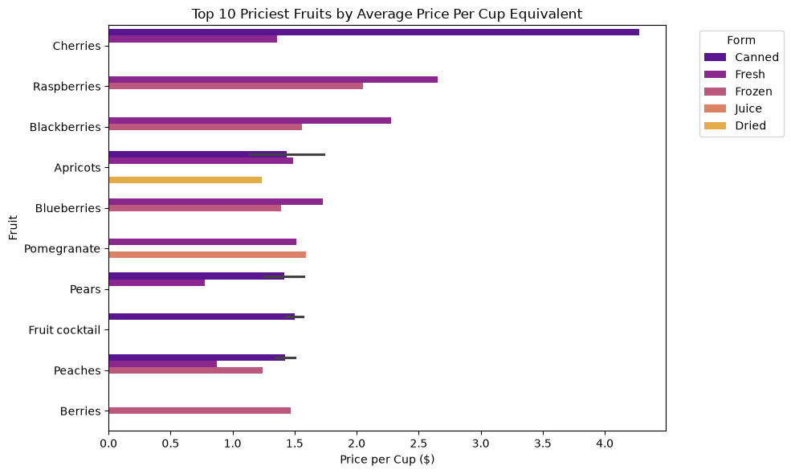
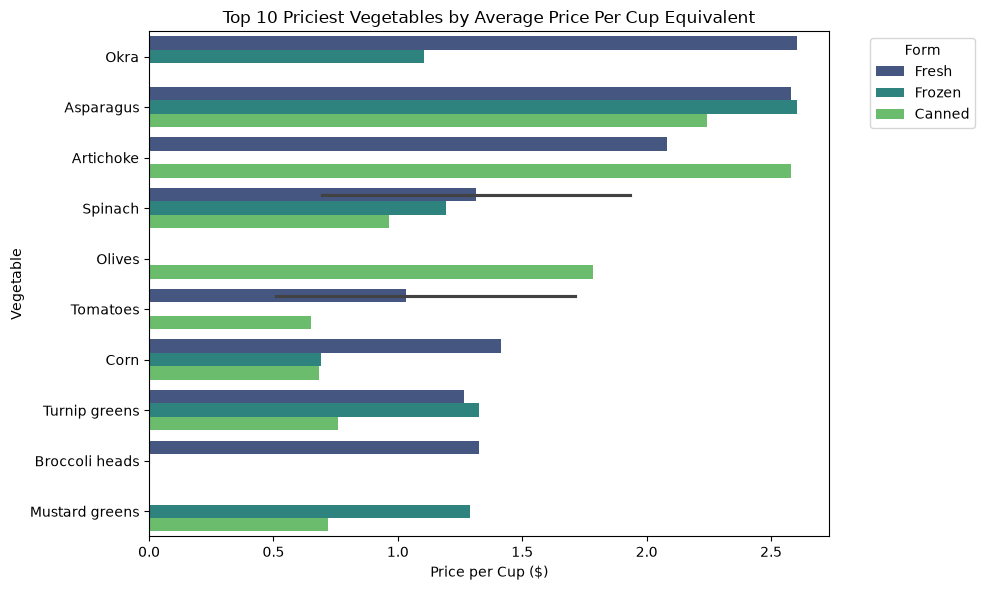
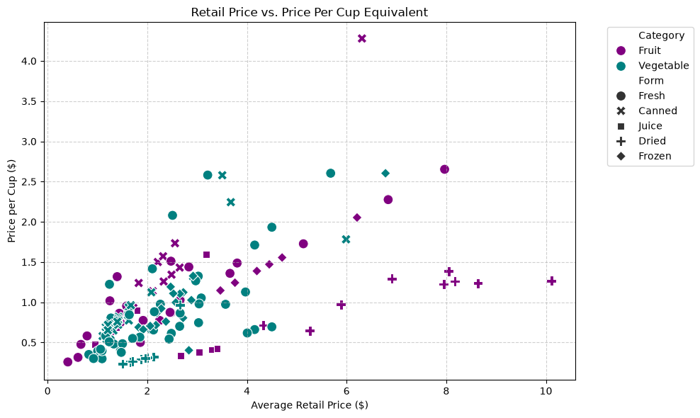

# finalProject
For use in the class I'm taking.

It's all well and good to do cool data manipulation, but...
## What do we gain from it?

In this case, we're learning a lot about fruit and vegetables, and the average economics surrounding them.

Example: AverageRetailPrice vs. AveragePricePerCupEquivalent has a correlation value of 0.590135, meaning they're moderately positively correlated. Those were a lot of big math words, but essentially it means if something has a higher sticker price, it will generally cost more per cup you eat. 

Example 2: PreparationYieldFactor vs. AveragePricePerCupEquivalent has -0.290670, indicating a moderate negative relationship. This means that as the yield of your food goes up, the price goes down. (Like when you use apple juice concentrate and add water, making the actual price per cup of the final product incredibly low.)

This is great info, but it's also just info. What did I learn from my visualizations?

# Visualizations and what they mean

#### First we have 'Top 10 Priciest Fruits'.

Observation 1: Canned cherries are expensive. Someone on a budget would probably want to avoid those.

Observation 2: Besides the outlier of canned cherries, the priciest fruit is actually fresh, while frozen is often cheaper or lower on the list.

The outlier there is orchard fruit, such as pears and peaches, where fresh is quite a bit cheaper compared to other preparation methods.



#### Next, 'Top 10 Priciest Vegetables'.

Observation 1: There are a lot of vegetables and preparation types vying for first place, but everything below them is close to a dollar cheaper, or more.

Observation 2: Canned and frozen veggies are almost always cheaper! For example, Okra drops from $2.60/cup (fresh) to $1.11/cup (frozen). 

This led me to...

Observation 3: The price difference between individual vegetable's prep methods varies wildly. Tomatoes vary from $0.51/cup all the way to $1.71/cup. This is due to different varieties of tomato in the same category (fresh), such as cherry or roma. Someone prioritizing price might go for the cheaper Roma, though someone wanting Cherry for their pasta salad might get it regardless of price.


#### Finally, 'Retail Price vs. Price Per Cup Equivalent'.

Observation 1: Higher retail price doesn't always mean a higher cost per serving. While the chart shows expensive items are often pricier per cup, this isn't always the case, and the points on said chart fan out.

Observation 2: There's a cluster of dots in the bottom left, which have low retail price *and* low price per cup (retail price under $2.00 and per-cup cost under $1.00), making them the best "value" options.


-
-
-

Now that you (hopefully) understand what this project is meant to accomplish, here's how I did it:
### Step 1 and Step 2: Find a Dataset, and Import it

I got my CSVs from the links below.
https://www.ers.usda.gov/data-products/fruit-and-vegetable-prices 

(https://www.ers.usda.gov/media/6240/all-vegetables-average-prices-csv-format.csv?v=33692) 

(https://www.ers.usda.gov/media/6210/all-fruits-average-prices-csv-format.csv?v=54815) 

Now that I have the data, I can import it like so:

```
import pandas as pd
fruit = pd.read_csv('fruit-prices-2023.csv')
veg = pd.read_csv('vegetable-prices-2023.csv')
```

### Step 3: Data Cleaning
Fruit and Vegetables had commas separating the base name and the type, but I wanted a separate column for fruit names, so I made one.
It made future plots immensely easier.

### Step 4: Data Manipulation
Among other things, I grouped by produce name to find the max price per cup, sorted in descending order. Then I filtered that to find the ten priciest fruits, and ten priciest vegetables, and finally merged the fruit and vegetable DataFrames to make a scatterplot, which leads me into...

### Step 5: Visualizations
In all visualizations Fruit is mostly purple and pink, and Vegetables are generally teal, blue, and green. This keeps things easy to read and tell apart across different visualizations.


### Step 6: Statistical Analysis
I ran the code below:
```
# Strip any leading/trailing whitespace from column names
fruit_clean.columns = fruit_clean.columns.str.strip()
veg_clean.columns = veg_clean.columns.str.strip()

full_combined = pd.concat([fruit_clean, veg_clean], ignore_index=True)

# Select numeric columns for correlation analysis
numeric_cols = [
    'AverageRetailPrice',
    'PreparationYieldFactor',
    'SizeOfACupEquivalent',
    'AveragePricePerCupEquivalent'
]

# Calculate the correlation matrix
corr_matrix = full_combined[numeric_cols].corr()
print(corr_matrix)
```
And got the results identified earlier.

I also ran some general descriptive statistics code, which is where I found something fascinating. Dried produce has the highest average retail price ($4.75/lb) yet it also has the second-lowest price per cup ($0.76/cup), because removing water weight means a single pound yields many cups.


